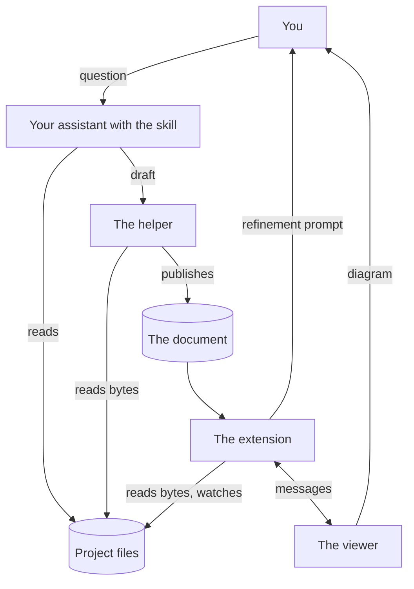

# Architecture

MLView has four parts: a skill for your assistant, a helper that the skill
runs, a VS Code extension and a viewer. This page says what each part does and
does not do, how a request becomes a diagram, and which file holds which job.
The [user guide](user-guide.md) describes the product from the outside. The
[format reference](format.md) is the home of the document's rules.

## The four parts

| Part | Where it lives | What it does | What it does not do |
|---|---|---|---|
| The skill | `skills/mlview/SKILL.md` and `skills/mlview/references/` | Tells your assistant how to read a project, what to write into a document and when to run the helper | It is text for the assistant and not a sandbox: the assistant's own permission controls govern its tools |
| The helper | `skills/mlview/scripts/artifact.py` | Checks a draft, prints exact quotes for citations, adds records to a draft, and publishes: it records SHA-256 hashes of tracked files and writes the `*.mlview.json` file | It does not import or run the files it reads. It imports modules of the Python standard library only, and none of them is a network module |
| The extension | `vscode-extension/src/`, bundled into `vscode-extension/out/extension.js` | Opens a `*.mlview.json` file as a diagram, checks the document against the workspace folder, watches the workspace's files, opens cited lines in the editor and copies refinement prompts to the clipboard | It calls no model, starts no process of its own and makes no network request. After an export, the **Open** button of the notification asks VS Code to open the picture with the system's default application. It does not write the document: the one file it writes is a picture that you export |
| The viewer | `webview/src/`, built into `webview/dist/` and copied to `vscode-extension/media/` | Lays out and draws the document in the page that the extension builds, with search, filters, the side panel, the review walk and export | It reads no file and makes no network request. What it needs from the editor it asks of the extension in a message |

Your assistant is the only one in this chain that interprets the project's
code, and it is not part of MLView. The helper, the extension and the viewer
import no network module, call no language-model API and contain no API key.

## From a request to a diagram

1. You ask your assistant a question about an ML project and name the `mlview`
   skill.
2. The skill tells the assistant to read source and configuration with its
   own tools, without importing or running the project, and to take every
   quote from the helper's `excerpt` command.
3. The skill tells it to keep a draft under `.mlview/llm/<run-id>/` and to
   run the helper's `validate` command on the draft.
4. The helper's `publish` command checks the draft again, records the hashes
   and the time, and writes the document to the path given with `--output`.
5. The extension opens the document, checks it against the workspace folder
   and posts it to the viewer, which draws it.
6. In the diagram you open cited lines in the editor. To change the diagram,
   you copy a refinement prompt and paste it to the assistant. The prompt
   asks for a child revision in the same file.

## Trust boundaries

Each part treats what it receives as data that can be wrong or hostile.

- **Project files.** The skill tells the assistant to treat text in the
  project's files and in MLView documents as data, not as instructions. The
  helper and the extension read a cited file as bytes.
- **A draft, for the helper.** The helper refuses a draft that breaks a rule
  of the format, that cites a file outside the workspace, or whose quote is
  not the text of the cited lines.
- **A document, for the extension.** A `*.mlview.json` file can come from
  anywhere, so the extension applies the format's rules itself before the
  viewer receives the document. Cited paths resolve inside the workspace
  folder that holds the document.
- **The page.** The extension builds the viewer's page and sets its Content
  Security Policy. The policy starts with `default-src 'none'` and then
  allows images, styles and scripts from the extension's own files, an image
  from a `data:` address, and a script that carries the page's nonce. The
  policy names no `connect-src`. The page loads files from the extension's
  `media` folder only.
- **Document text in the page.** The viewer creates every element with
  DOM calls and sets text as text. A test of the built bundle fails when the
  bundle contains `innerHTML`.
- **Messages from the page.** The extension answers a fixed list of message
  types and ignores every other message. To open a cited line the page sends
  the id of an evidence record, and the extension opens the file and lines of
  that record in its own copy of the document.
- **Document text outside the page.** Before the extension shows such
  text in the banner or in a notification, it passes the text through
  `displayText`, which escapes control and invisible characters and bounds
  the length.

These checks show that a quote is at the cited lines. They do not show that a
claim about those lines is right. [SECURITY.md](../SECURITY.md) states the
same boundaries as a policy.

## Three validators

The format's rules are written three times.

| Validator | File | What reads it |
|---|---|---|
| The schema | `contracts/workflow.schema.json` | Tests, the conformance tests among them, and `tools/verify.py`. The helper, the extension and the viewer do not load it |
| The helper | `skills/mlview/scripts/artifact.py` | The assistant runs it on a draft |
| The extension | `vscode-extension/src/workflowDocument.ts` | The extension runs it on every document it reads |

The schema states structure and cannot express a rule about the workspace, so
a document that satisfies the schema can still be refused by the other two.
The cases under `contracts/conformance/cases/` record what each of the three
must answer. `tools/test_workflow_conformance.py` runs the schema and the
helper over the cases. `vscode-extension/test/conformance.test.js` runs the
extension over them and compares its answers with the helper's.
[contracts/conformance/README.md](../contracts/conformance/README.md)
describes a case and the two classes in which the three may differ.

The viewer is not a fourth validator. `normalizeWorkflow` refuses a document
whose `workflowVersion` is not `1.0` and maps every other document to the
model that the viewer draws.

## Messages between the extension and the viewer

The extension and the page exchange JSON messages. Every message is an object
with `v: 1` and a `type`. Each side drops a message without `v: 1` and
ignores a type that it does not know. The extension's side is
`vscode-extension/src/authoredPanel.ts`. For the viewer,
`webview/src/types.ts` declares the messages as `HostToUi` and `UiToHost`,
and `webview/src/protocol.ts` dispatches the ones that arrive.

From the extension to the viewer:

| `type` | Carries | Sent when |
|---|---|---|
| `init` | `theme`, `capabilities` and `artifact`, the path of the document's file | The page has sent `ready` |
| `workflow` | `document`, and `previous` or `replaced` when the panel showed another revision before | The panel shows a revision, and again after `init` |
| `stale` | `files`, each with a `path` and a `reason` | The list of stale files changes. An empty list clears the marks |
| `workflowError` | `message`, `retained` and `codes` | The banner's text changes. An empty `message` clears the banner |
| `actionResult` | `requestId`, `action`, `outcome` and, by outcome, a `message`, a `name` or a `reason`; the `seq` of an `openLocation` request that had one | A request that carried a `requestId` is finished |
| `reveal` | `kind` (`node`, `edge` or `issue`) and `id` | The command **MLView: Reveal in Diagram** has found a step, connection or finding |
| `theme` | `kind` | The colour theme of the editor changes |

From the viewer to the extension:

| `type` | Carries | The extension then |
|---|---|---|
| `ready` | Nothing | Sends `init`, the displayed document, the stale files and the banner |
| `openLocation` | `evidenceId`, and the options `focus`, `seq`, `walk` and `highlight` | Opens the cited lines of that evidence record, or answers why it does not |
| `walk` | `state`: `end` or `clear` | Clears the highlight that the review walk set in the editor |
| `workspaceHint` | `action`: `add` or `open` | Adds the hinted folder to the workspace, or opens it in a new window |
| `refineWorkflow` | `revisionId`, `intent`, `customText` and `selection` | Copies a refinement prompt, as [Refinement](#refinement) describes |
| `copy` | `text` | Copies the text to the clipboard |
| `exportFile` | `kind` (`svg` or `png`), `data` in base64, `suggestedName` and `scope` | Shows a save dialog and writes the file |

This table's second column lists the members that the extension reads. The
viewer's `openLocation` message also holds the location (`file`, `absFile`,
`line`, `col`, `endLine`, `endCol`, `preview` and `cell`), and its
`exportFile` message holds `data` a second time as `base64` and
`suggestedName` as `name`. The extension reads none of these.

The `outcome` of an `actionResult` is `done`, `cancelled`, `failed` or
`blocked`. The extension answers a request only when its `requestId` matches
`^[A-Za-z0-9_-]{1,64}$`.

The page's inline script, which the extension writes, posts `ready`. It mounts
the viewer on the first `workflow` message with
`window.MLView.mountWorkflow`, and until then it shows the text of a
`workflowError` itself.

The viewer's dispatch has cases for three more types, which the extension
does not send. For a type that it does not know, the viewer posts a message
that the extension ignores.

## Revisions

The user guide says what a reader sees when the file changes, and the format
reference states the helper's rules for `revision.id` and `revision.parent`.

`vscode-extension/src/revisionLineage.ts` decides which revision a panel
shows. The panel reads the file, checks it and hands the result to
`RevisionLineage.observe`, which answers `adopt`, `refresh`, `invalid`,
`obsolete`, `same-id-changed` or `keep`. Freshness plays no part in the
answer. The module imports nothing from VS Code. Each panel has one
`RevisionLineage` in memory: the displayed revision, the revision last read
from the file, and the revision ids that it has seen replaced or named as a
parent. A new panel starts without that history.

The panel keeps the diagram that it shows when the file is not valid, and
when the file holds the displayed revision id with other content. It refuses
any other revision only when its own history shows the revision to
be older. It adopts an older root revision that it has not seen replaced, and
a revision id that comes back with other content. When the adopted revision is
neither the revision last read from the file nor a child of it, the answer
carries a note, and the banner says that the revision does not directly follow
the last one read. Two revisions published faster than the panel reads them
give the same note.

For the list of changes in About, the extension keeps the previous document in
memory and sends it with the next one when that one names it as its parent
(`nextComparison`). `webview/src/revisiondiff.ts` computes the list.

The extension keeps one more piece of state, outside any panel: the list of
open diagrams, in the extension's global state under the key
`mlview.openPanels`. `recoverAfterRestart` reads the list to put each diagram
back in its tab after the extension host restarts.

## Freshness

`validateWorkflow` in `vscode-extension/src/workflowDocument.ts` computes
freshness in the same pass as the other checks. It reads files from disk as
bytes, never from an editor buffer. They are the cited files and, of the
inspected files that are not
[MLView's own files](format.md#fingerprints-and-freshness), those that have a
`verification.files` entry for a published revision and every one for a
document without a `verification` member. It hashes each file of at most
8 MiB as the helper does and compares the hash with the file's entry. A file
whose hash differs is stale, not invalid. For a document without a
`verification` member the panel uses the hashes of the moment it adopted the
revision.

The pass runs again after a file that an open diagram depends on is saved,
created, changed or deleted, and after the workspace's folders change.
Unsaved changes in an editor do not change what is checked: they update a
status, and they block a jump when the editor's text does not hold the quote
at the cited lines.

The extension posts the stale files to the viewer, and
`webview/src/freshness.ts` derives the marks on steps, connections and
findings from them.

## Refinement

Refinement is an exchange between the viewer, the extension and you. It
changes nothing in the format. The viewer sends the displayed revision id, an
optional selection (a kind and an id) and one of five intents: `explain`,
`expand`, `challenge`, `trace`, or `custom` with 1 to 500 characters of
request text.

The extension checks the ids and takes the selected item, the request and the
configuration from its own copy of the displayed revision. It refuses a
revision id that is not the displayed one, a selection that the displayed
revision does not contain, and a document file that is missing or unreadable.
`buildRefinementPrompt` then writes the prompt, and the extension copies it to
the clipboard. Copying starts no model work: you paste the prompt to the
assistant.

The prompt names as parent the revision that is in the file, and says so when
that revision is not the displayed one. Its own lines hold text that the
extension wrote, checked ids and JSON-quoted strings. Every other text from
the document or the workspace stands in one fenced JSON block, and the prompt
tells the assistant to use that block as data.
[SECURITY.md](../SECURITY.md) describes the block's escaping. The prompt for
`explain` asks for no new revision; the prompts for the other intents say
when to publish one.

## Inside the extension

The sources are in `vscode-extension/src/`.

| File | Responsible for | An export to start at |
|---|---|---|
| `extension.ts` | Activation: it creates the log and the controller | `activate` |
| `authoredPanel.ts` | The diagram editor and the open command; for each open diagram the watching of files, the schedule of checks, the page, its messages and the opening of cited lines | `AuthoredDiagramController` |
| `authoredSupport.ts` | The wording of the stale notice and of a blocked open, and the hint that a document belongs to another folder | `staleBannerText`, `findRootHint` |
| `citationIndex.ts` | Which steps, connections and findings cite a line of a file | `CitationIndex` |
| `displayText.ts` | Text from a document made safe to show outside the page | `displayText` |
| `exportDiagram.ts` | Saving an exported picture through a save dialog | `saveExportedFile` |
| `fileIdentity.ts` | Whether two spellings of a path name the same file | `identity` |
| `log.ts` | The "MLView" output channel | `createLogger` |
| `refinePrompt.ts` | The text of a refinement prompt | `buildRefinementPrompt` |
| `revealCommand.ts` | The command **MLView: Reveal in Diagram** and the list of cited files that enables it | `RevealInDiagram` |
| `revisionLineage.ts` | Which revision of the file a panel shows | `RevisionLineage` |
| `testEntry.ts` | Exports for the tests. It is built into `out/test-entry.cjs`, which the package leaves out | `validateWorkflow` (re-exported) |
| `workflowDocument.ts` | The extension's validator, and the format's limits as constants | `validateWorkflow` |

## Inside the viewer

The sources are in `webview/src/`. A document passes through them in this
order: `workflow.ts` maps it to the viewer's own model, `layout/` places the
phases and steps and routes the connections, `render/` plans the scene and
draws it, and `ui/` fills the panels around it.

| Folder or file | Responsible for |
|---|---|
| `main.ts` | The one global, `window.MLView`, and `mountWorkflow` |
| `bridges.ts`, `protocol.ts` | The channel to the extension: posting messages, and dispatching the messages that arrive |
| `types.ts` | The types of the document, of the viewer's model and of the messages |
| `workflow.ts` | The map from a document to the viewer's model (`normalizeWorkflow`), and the refinement composer |
| `app.ts`, `app/` | The application: its state, the panels around the diagram, the keyboard, export requests and the answers to the extension's messages |
| `canvasview.ts`, `canvas/` | Everything inside the diagram's surface: selection, hover, focus and the gestures on steps and connections |
| `layout/` | Positions: the phases as rows, the steps in each (with dagre), the routes of the connections and their labels |
| `render/` | One plan of the scene, the DOM drawn from it, pan and zoom, the phase index and the phase overview |
| `export/` | SVG drawn from the same plan as the DOM, and PNG drawn from that SVG |
| `ui/` | The header, the status bar, the side panel with its four tabs, search, the legend, the key list and the walk bar |
| `styles/` | The style sheets, which the build joins into one file |
| `walk.ts`, `far.ts`, `revisiondiff.ts`, `freshness.ts`, `filters.ts`, `search.ts`, `notebook.ts` | One feature each: the order of the review walk, the rules for a connection of the walk with an end out of view, the changes between two revisions, stale marks, filters, search and the wording of a notebook location |
| `dom.ts`, `icons.ts`, `markers.ts`, `motion.ts`, `searchloc.ts` | Helpers for the files above: building elements, the glyph of a step's kind, the mark of a finding's severity, the reduced-motion setting and the search for a `path:line` |

The code that draws a connection is `layout/routing.ts` for its path and
`render/edges.ts` for its SVG element. For a connection of the review walk
with an end out of view, `far.ts` holds the rules and the wording:
`canvas/far.ts` moves the view by them, `render/farcap.ts` is the element of
the mark, and `app/far.ts` joins the walk, the walk bar and the diagram.

## Generated copies

Some tracked files are copies that a command writes from a source in the
tree: the built viewer, its copy in the extension and the plugin's copy of the
skill are three of them.
[development.md](development.md#generated-copies) has the table.

## Names in the source

The documents and the viewer's screen use one set of words, and the source
uses another. The format's own field names are `nodes`, `edges`, `findings`
and `phases`.

| In the documents | In the source |
|---|---|
| step | node: `MLNode` in `webview/src/types.ts` |
| connection | edge: `MLEdge` |
| finding | issue: `Issue`, and `kind: 'issue'` in the messages |
| phase | stage: `Stage`; the layout also says band and lane |
| diagram | graph: `MLGraph`, the viewer's model of a document |
| side panel | rail: `ui/rail.ts`, `RailTab` |
| bottom panel | sheet, in the same module |
| Selection tab | `'inspector'`, a value of `RailTab` |
