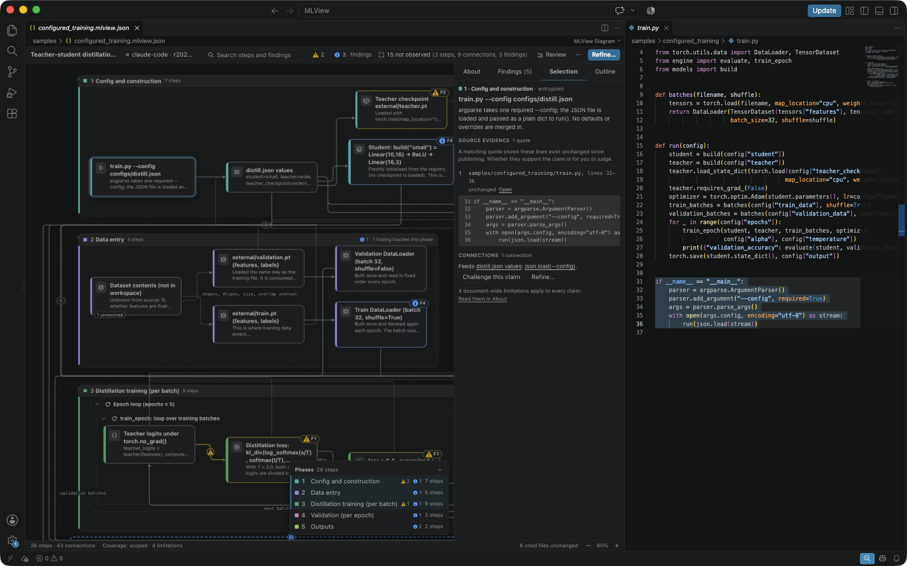
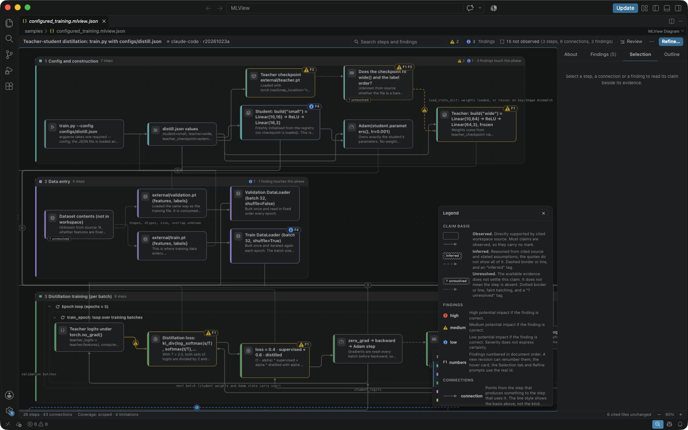
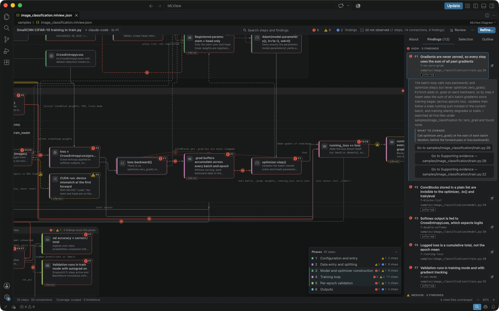
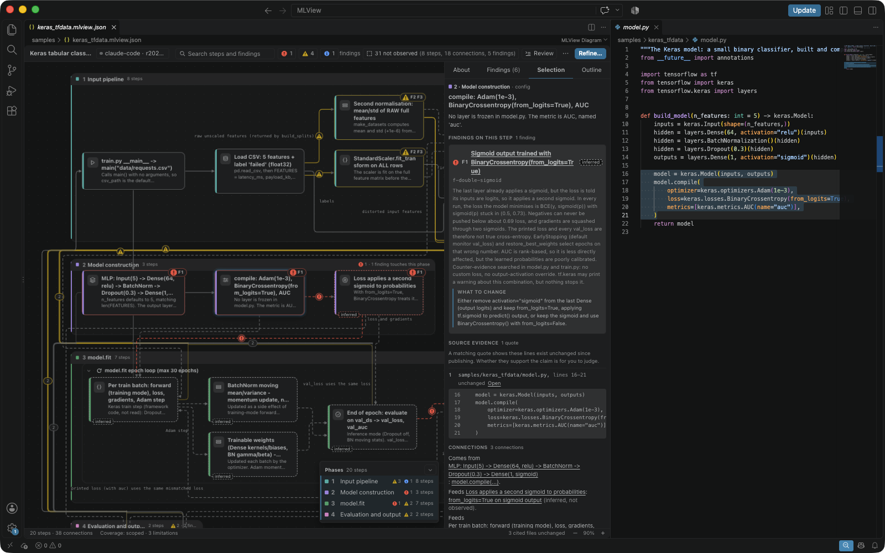
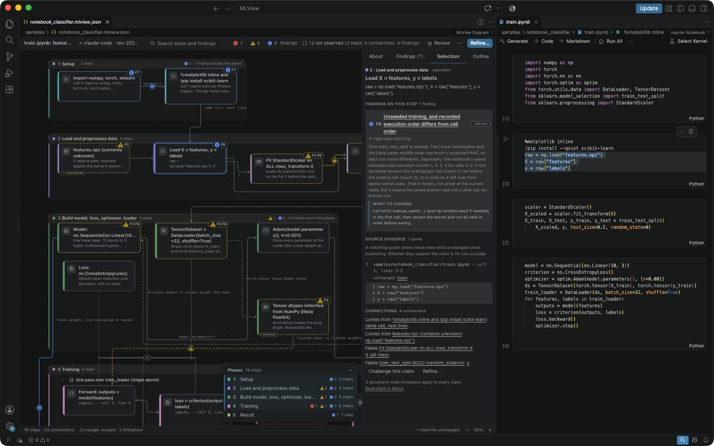
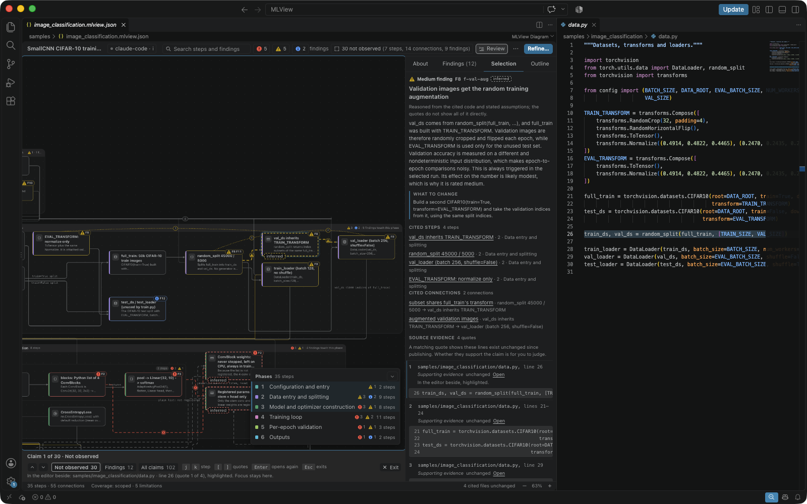
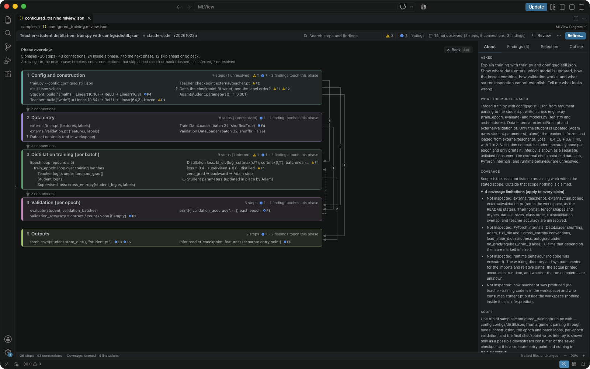
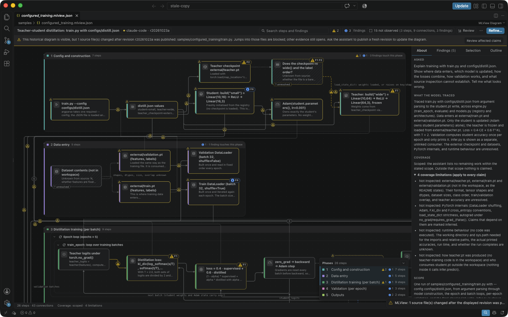

# MLView user guide

MLView is a skill for your coding assistant and an extension for VS Code. The
skill has the assistant read the source, configuration, notebooks and
documentation of a machine-learning project and write a diagram of what the
code does: a `*.mlview.json` file whose claims cite the lines they rest on.
The extension opens that file. Your assistant's own model, permissions and
limits apply. MLView has no API key of its own and calls no model.

Where this guide says what VS Code or an assistant does, it says what that
product is expected to do. The behaviour depends on the product and on its
version.

## What a diagram contains

| Part | What it is |
|---|---|
| Step | One thing the code does, with a title and optionally a kind and a longer description. |
| Group | A step that has child steps. |
| Connection | A directed link between two steps, with a label and optionally a kind such as `data`, `control` or `call`. |
| Phase | A named part of the workflow. Each step belongs to one phase. |
| Finding | Something to look at: a title, a description, a severity, the steps and connections it concerns and, optionally, a suggestion. |
| Claim | A step, a connection or a finding. Each has a basis and a list of quotes. |
| Quote | A range of lines in a file of the project, or in a notebook cell, with the exact text of those lines. A finding can also carry counter-evidence: quotes that weaken or limit it. |
| Coverage | A status, a summary of what was traced, the files that were inspected and the limitations. The status is `scoped` when no named work remains and `partial` when some does. |
| Revision | One published state of the diagram. A refinement is a new revision, and it names the revision before it as its parent. |

In the file, a step is a record of `nodes`, a connection a record of `edges`
and a quote a record of `evidence`.
[The format and the helper's commands](format.md) describes the file.

The basis says how a claim rests on its quotes:

| Basis | Meaning |
|---|---|
| observed | The cited lines establish the claim directly. |
| inferred | The claim is reasoned from the cited lines and from stated assumptions. The quotes do not show all of it. |
| unresolved | The lines at hand do not settle the claim. It does not mean that the step is absent. |

The severity says what kind of consequence a finding names:

| Severity | Meaning |
|---|---|
| high | Silently wrong results in the scenario that was analysed. |
| medium | A risk that depends on a stated condition, or a failure that shows itself when it happens, such as an exception. |
| low | Reproducibility or observability. |

The assistant assigns both labels. The helper, the Python script that the
skill carries, checks that each label is an allowed value and that a claim
without quotes is unresolved or is a group. No check tests whether a label
fits the code.

## Install

The extension is installed in VS Code. The skill is installed in each project
that you want a diagram of; for Claude Code it is also packaged as a plugin.

### The extension

The extension needs VS Code 1.100.0 or newer, as its manifest declares in
`engines.vscode`. Opening a diagram needs no Python.

Each release attaches the extension (a `.vsix` file) and the two skill ZIPs
to its page under Releases. Download the `.vsix` file from the release. To
build it in a clone of this repository instead, follow
[docs/development.md](development.md#prerequisites). In VS Code, run
**Extensions: Install from VSIX...** and choose the file. A newer `.vsix` file
is installed the same way.

### The skill, per assistant

The skill is a folder named `mlview`. It holds the instructions for the
assistant (`SKILL.md`), reference files and the helper
(`scripts/artifact.py`). Where an assistant looks for skills depends on the
assistant and on its version. The expected folders are:

| Assistant | Folder of the skill | Skill ZIP |
|---|---|---|
| Codex | `.agents/skills/mlview/` | `shared` |
| GitHub Copilot in VS Code | `.agents/skills/mlview/` | `shared` |
| Claude Code | `.claude/skills/mlview/` | `claude-code` |

Use one of the two folders in a project, not both. GitHub Copilot is expected
to read both folders, and would find two skills with the same name.

### From a skill ZIP

A skill ZIP holds the skill at the path where it is used:
`.agents/skills/mlview/` in the `shared` ZIP and `.claude/skills/mlview/` in
the `claude-code` ZIP. Each release attaches both, as
`mlview-skill-shared.zip` and `mlview-skill-claude-code.zip`. Download the
one for your assistant. Or build one in a clone:

```sh
python3 tools/package_skill.py --host shared
python3 tools/package_skill.py --host claude-code
```

Each command writes its ZIP into `.mlview/dist/` and prints the path. Extract
the ZIP at the root of the project:

```sh
unzip -q .mlview/dist/mlview-skill-shared.zip -d /path/to/project
```

The project that received the ZIP needs no clone. To check the result there,
run the helper:

```sh
python3 /path/to/project/.agents/skills/mlview/scripts/artifact.py --help
```

It prints its usage and exits with status 0. A ZIP holds no installer and no
doctor. If you extract with another tool, the result must be the same layout:
the folder `mlview` directly under `.agents/skills/` or `.claude/skills/`.

### If you have a clone

The installer copies the skill into a project:

```sh
python3 tools/install_skill.py /path/to/project
```

The skill goes to `.agents/skills/mlview/`. For Claude Code, name the other
folder:

```sh
python3 tools/install_skill.py /path/to/project --destination .claude/skills/mlview
```

The copy does not depend on the clone afterwards. The installer also writes
`.mlview-install.json` into the folder, with the SHA-256 of every file it
installed.

Run the installer again to upgrade. It replaces the files that you did not
change, and it removes an unchanged file that the new skill does not ship. It
refuses a file that you edited:

```text
destination has local edits: <files>. Back them up and rerun with --force to replace them.
```

It stops when the folder holds a file that is not part of the skill, with or
without `--force`. It leaves editor and system files, such as `.DS_Store`,
alone. Move the file out of the folder and run the installer again. A folder
without `.mlview-install.json`, such as one extracted from a skill ZIP, needs
`--force` for every file that differs from the new skill.

The doctor checks a project and changes nothing:

```sh
python3 tools/install_skill.py /path/to/project --doctor
```

It prints JSON and exits with status 0 when Python is 3.10 or newer and one
of the two folders holds a complete, unedited skill. It reports missing,
edited and unexpected files, a skill in both folders, and a skill folder that
is a symbolic link. It does not show whether an assistant finds the skill.

### The Claude Code plugin

The folder `claude-plugin/` packages the same skill as a plugin for Claude
Code. [claude-plugin/README.md](../claude-plugin/README.md) has the commands.

### Upgrade or remove the skill

- With a clone, update the clone and run the installer again.
- From a ZIP, delete the folder `mlview` and extract the new ZIP.
- To remove the skill, delete the folder `mlview`.
  `.mlview-install.json` lies inside it.

The helper and the extension accept only `workflowVersion` `"1.0"`.

## Ask for a diagram

### Start the skill

Open the project in your assistant. How a skill is started depends on the
assistant and on its version:

| Assistant | To start the skill |
|---|---|
| Codex | Type `$mlview` and then the request. Codex is expected to start the skill. |
| GitHub Copilot in VS Code | Choose `mlview` in the skill picker and type the request. GitHub Copilot is expected to offer the skill there. |
| Claude Code | Type `/mlview` and then the request. Claude Code is expected to start the skill. |

Name the entrypoint and the configuration when you know them, and say what
you want to see:

> Explain training with train.py and configs/distill.json. Show where data
> enters, which model is updated, how the losses combine, how validation
> works, and what source inspection cannot establish. Tell me what looks
> wrong.

### What the session does

The skill instructs the assistant to read the project with its own tools and
not to import the project or run its code. The assistant chooses the steps
and connections, looks for other readings of the code and writes a draft.
Then it runs the helper with `python3`. The helper needs Python 3.10 or
newer.

The helper checks the draft's structure and paths, and that every quote
equals the cited lines. It does not choose the steps, the findings or what
the diagram means. When it reports errors, the assistant repairs the draft
and tries again. The skill allows two rounds of repair unless you set another
limit.

A session writes:

- A working folder, `.mlview/llm/<run-id>/`, which holds the draft. The
  helper cites and fingerprints no file under `.mlview/`.
- The diagram, by default `workflow.mlview.json` in the workspace folder.

This repository's own `.gitignore` lists `.mlview/`. Before you commit a
diagram, read
[What leaves your machine, and what a diagram file holds](#what-leaves-your-machine-and-what-a-diagram-file-holds).

One file holds one diagram. A refinement replaces the revision in the file
with a new one. For a second question that has nothing to do with the first,
ask for another file name that ends in `.mlview.json`.

For a broad request the assistant can publish a partial diagram first. Its
coverage lists what was not inspected. A fuller revision can follow.

Model work happens only when you ask the assistant. Opening a diagram,
filtering it and jumping to the code call no model. A copied prompt is a
request only when you send it.

Stop a session with your assistant's own controls. MLView does not control
the session. When a session is stopped or fails, the file keeps the last
published revision, and a first session may have published nothing.

## Open and read a diagram

### Open it

Click the `*.mlview.json` file in the Explorer. It opens as the diagram, in a
read-only editor named **MLView Diagram**. **MLView: Open Generated Diagram**
is in the Command Palette, in the context menus of the Explorer and of the
editor, and in the title bar of the file when it is open as text. The command opens the diagram beside
the editor that you are in and keeps the focus there. To see the JSON, VS
Code is expected to offer **View: Reopen Editor With...** with the entry
**Text Editor**.



The diagram of `samples/configured_training`, with a step selected.

Several diagrams can be open at once, the same file twice included. Each has
its own selection and its own review walk. The diagram is drawn from the file
on disk, never from unsaved text in an editor.

The viewer resolves the quotes against the workspace folder that holds the
diagram file. The file cannot name another folder or an absolute path. A file
that the viewer cannot draw opens a page that says why: it is not a local
file, its name does not end in `.mlview.json`, or it lies outside every
workspace folder.

### The side panel

The panel beside the diagram has four tabs: **About**, **Findings**,
**Selection** and **Outline**. A new revision opens on About. After that the
viewer keeps the tab that you chose for that revision.

About describes the diagram as a whole: the request (**Asked**), the coverage
summary (**What the model traced**), the coverage status with its limitations,
the scope and the entrypoints, the configuration, every cited file with its
freshness, and the provenance. It carries the line "Model-authored; MLView
checks citations, not the interpretation." The revision in the header and
**Coverage** in the status bar open About.

Findings lists the findings. Outline lists the phases with their steps.
Under **Text relationships** it lists the connections as text: all of them,
those into or out of the selected step, or those that are unresolved or touch
an unresolved step. These are direct connections only.

When the diagram's editor is narrow, the side panel becomes a bottom panel
under the diagram: a strip of tabs that opens when you select something. Drag
its handle to resize it. The chevron or Escape collapses it. `b` shows or
hides the side panel, or opens or collapses the bottom one. `t` moves the
keyboard to the panel's tabs, where the arrow keys choose a tab.

When the diagram changes size and hides the selected step, the diagram pans
just far enough to show it again. With VS Code's screen-reader optimisation
on, a selection is announced by its claim and nothing animates.

### Basis marks, phases and findings

An observed claim carries no mark. An inferred step or connection has a
dashed border or line and an `inferred` tag. An unresolved one has a dotted
border or line and a `? unresolved` tag. The line style shows the basis, not
the kind of the connection: the hover card and the Selection tab name the
kind. The header's **N not observed** toggle fades the observed claims.
The legend (`l`) explains the marks.



The legend (key `l`) explains every basis mark, whatever this diagram holds.

Each phase has a colour that follows its place in the document. A phase
heading shows the phase's number and name, its step count and its findings by
severity. A finding that cites steps of two phases counts in both.

Finding badges read F1, F2 and so on, in the document's order. A new revision
can renumber them, so the Selection tab shows the finding's id with the
number, and a copied prompt uses the id.



The Findings tab of the diagram of `samples/image_classification`. The
maintainer wrote this project with mistakes on purpose. The findings are
the assistant's reading of the code, and they are not confirmed to be those
mistakes.

A step is drawn as a card with its title and two lines of its description.
Hovering a card rings its direct neighbours and lights its connections. Focus
mode (select, then `f`) lights the whole lineage of the selected step and
fades the rest. The connection animation runs twice and stops; Shift+A plays
it again, and VS Code's Reduce Motion setting turns it off.

### First view, header and search

A diagram opens at reading size: the whole diagram if it fits, otherwise the
first phase. Reopening the same revision keeps where you were. `0` returns to
the first view, and **Fit the whole diagram** in the **⋯** menu shows
everything. Zoomed far out, a card shows only its title.

The header holds the title, the assistant and the revision, search, a toggle
for each severity with its count, **N not observed**, **Review**, the **⋯**
menu and **Refine…**. In a narrow editor, search, the revision and **Review**
move into the menu. The menu also holds the phase overview, the legend, the
animation, the phase index, the panel, **Fit the whole diagram**, zoom to the
selection, the SVG and PNG exports and the shortcut sheet.

Ctrl+F (Cmd+F on macOS) or `/` moves to search. Search finds steps, findings,
ids and cited text. Each result shows its title and where it is cited.

The status bar counts the steps and the connections, shows the coverage
status, and says whether the cited files are unchanged, changed or missing.
The whole document is always drawn. To narrow what you look at, collapse
groups or use focus mode.

Escape closes one thing at a time, in the order that the
[key table](#keyboard) gives. When the viewer has nothing left to close, the
key goes to VS Code.

## Check a claim



A claim's quote and the lines that it cites.

### Select, and open the cited lines

Click a step, a connection or a finding to select it. A click never opens a
file. Enter, a double-click or a quote's **Open** link opens the cited lines
beside the diagram, selected and highlighted, and the keyboard stays on the
diagram. Alt+Enter, or Alt+click on an **Open** link, also moves the focus to
the editor. A double-click on a group collapses it. In High Contrast themes
the opened lines are outlined, and the highlight also marks the editor's
overview ruler.

The lines open in an editor group that you already have, never in the
diagram's own: the group that shows the file, else the group of the last
jump, else the group that you last worked in. A diagram that is alone in the
window opens a new group beside it.

A quote in a notebook names a cell and the lines inside that cell. Cell
numbers start at zero and count markdown cells, and line numbers start at one
inside the cell. The viewer prints the cell number as the file records it.
Opening the quote selects the cell, and its lines are highlighted when VS
Code has the cell's editor ready. Reading a notebook does not establish the
order in which its cells ran.



A quote that cites lines inside a notebook cell, opened in the notebook.

An unresolved step and a group can have no quotes. Such a claim has nothing
to open, and the Selection tab says why.

### The Selection tab

The Selection tab shows the selected claim in full. For a step it shows the
phase, the kind and the group; the title; a note on the basis when the step is
inferred or unresolved; the description; the findings on the step, each with
**What to change**; every quote with its line numbers, a word on whether its
file is unchanged, and **Open**; where the step's input comes from and what
the step feeds; and the buttons **Challenge this claim** and **Refine…**.

A connection shows its kind, label, ends, basis, findings and quotes. A
finding shows its severity, number and id, its title and description, **What
to change**, the steps that it cites, and its quotes in one numbered list,
each marked as supporting evidence or counter-evidence. A group shows the
findings inside it, its steps and the connections that cross its border.

A caption above the quotes says that a matching quote shows that the lines are
unchanged since publishing, not that they support the claim. **Challenge this
claim** starts a [Refine](#refine) request that asks the assistant to check
the claim again.

A selection made on the diagram, from a search result or from a link shows
the Selection tab. A row chosen in the Findings list or in the Outline keeps
that list in place.

### The review walk

The review walk goes through a revision claim by claim and opens the cited
lines of each claim beside the diagram. Start it with `r`, with **Review** in
the header or with **Review the claims** in the **⋯** menu.

The walk follows the diagram's order: phase by phase, each step, then the
connections that leave it, then the findings that cite it first. Findings
that cite no step come last.

The walk starts on the claims that are **Not observed**: the inferred and the
unresolved ones. The walk bar under the diagram has the other filters, each
with its count: **All claims** and, when they hold a claim, **Findings**,
**Changed in this revision** and **Changed files**.



The review walk on a claim that is not observed.

Each move selects a claim, brings it into view (for a connection whose two
steps do not fit the diagram together at the walk's zoom, its start) and
shows it in the Selection tab. A moment later the claim's cited lines open
in the editor, highlighted, and the keyboard stays on the diagram. A claim
without quotes opens nothing. A quote is not opened when its file changed or
is missing, or when unsaved edits no longer contain the cited lines. The walk
bar says why; in a narrow editor it shows a warning mark and the Selection
tab says why.

While the walk is on a connection with an end out of view, the line of the
connection ends in a mark of three dots where it goes out of sight, if there
is room for one, and the walk bar shows a button that names the step at that
end and says which way and how far it lies. Press `o`, or click the mark or
the button: both ends are shown if they fit the diagram together; if not, the
view goes to that end, and the same again comes back. The left or right arrow
key towards that end brings it into view in the same way. The walk stays on
the connection through all of these. An arrow key towards the end that is in
view either moves nothing, and the viewer announces which end of the
connection it is, or selects that step, and the walk goes with it when its
filter holds the step. When the two steps of a connection with a dashed or
dotted line do not fit the diagram together at the walk's zoom, the walk may
zoom out, down to a fixed limit, and show both; there is then no mark.

The walk remembers its place for each revision, so `r` resumes there. A new
revision starts from the beginning. The walk marks nothing as checked and
writes nothing to any file. Its keys are in the [key table](#keyboard).

When cited files change, the banner above the diagram offers **Review affected
claims**, which walks the claims that cite those files.

### From code to the diagram

**Reveal in Diagram** goes from a line of code to the claim that cites it.
Right-click the line in the editor and choose it, or run **MLView: Reveal in
Diagram** from the Command Palette. MLView binds no key to it.

The command is offered in a file that an open diagram cites, as long as the
file has not changed since the revision was published. The cursor's line, or
the selected lines, decide the claim. When one claim cites them, the diagram
selects it, unfolds its group, brings it into view and shows it in the
Selection tab, and the keyboard moves to the diagram. When several claims
cite them, a list names each one: steps first, then connections, then
findings. On a line that no claim cites, the list offers the nearest claims
in the file. With several diagrams open, the one that cites the file is used,
or a list asks which.


Reveal in Diagram goes from a cited line of code to the claims that cite it.

The command works in the cell editors of a notebook. When unsaved edits have
moved the quoted lines, the command says so. A file that is open through
another path, such as a folder that is a symbolic link, is matched when the
command runs, but the menu offers the command only for the path that the
diagram records. The claims come from the quotes of the displayed revision:
MLView reads no code to find them.

## Move around a large diagram

The arrow keys move the selection to the next card in that direction. `e` and
Shift+E go through the connections of the selected step. `+` and `-` zoom,
and `z` zooms to the selection.

The phase overview shows the whole workflow at once. Press Shift+0, or choose
**Phase overview** in the **⋯** menu. Each phase is a block with its number,
its name, its step count, the number of steps that are inferred or
unresolved, and the findings that touch it. Under that come its step titles,
with a mark on the inferred and the unresolved steps and the labels of the
findings on each step. A block with more titles than fit ends with a count of
the rest, so every step is listed or counted.



The phase overview of the diagram of `samples/configured_training`.

An arrow between two neighbouring blocks says how many connections go from
one phase to the next. A connection that skips a phase or goes back is a
bracket at the side with its count, dashed when it goes back. The arrow keys,
Home and End move between the blocks. Enter or a click goes to that phase at
reading size. Escape, Shift+0 or **Back** returns to the diagram as it was.

The phase index sits in a corner of the diagram. It lists every phase with
its number, name, findings by severity and step count, and it marks the
phases in view. Click a row to go to that phase. When the diagram's editor is
narrow or short, the index is one line that names the phase most in view;
click the line to open the list. When you move to a card, the diagram pans it
out from under the index. **Phase index** in the **⋯** menu shows or hides it,
and the diagram remembers the choice. The item is disabled for a diagram with
fewer than two phases.

After you go to a phase from the phase overview or the phase index, and
before you select anything else, the next arrow key selects that phase's
first step. In the review walk only ← and → do this: ↓ and ↑ step through the
claims as usual, and the walk moves to the selected step when its filter
includes it. In a phase without steps the arrows act as usual.

## Refine

Ask for a change in the same conversation with your assistant:

> Refine workflow.mlview.json: expand the two loss terms and show why only
> the student is updated. Preserve stable IDs and supersede the current revision.

Or let the viewer write the request. Select a step, a connection or a finding,
choose **Refine…**, choose an intent and then **Copy prompt**. Paste the
prompt into the conversation. Copying it starts no model work. With no
selection the prompt is about the whole diagram. The **Refine…** box names the
item that it captured when it opened, so open it again after you change the
selection.

| Intent | What the assistant does | New revision? |
|---|---|---|
| Explain | Explains the item or diagram in the conversation, citing its evidence | Never; if the diagram is wrong, it says so and offers a corrected revision |
| Expand | Adds the sub-steps, data and state flow the item summarizes, with evidence | Yes |
| Challenge | Re-checks the claim against the source, then keeps, qualifies or removes it | Only if something changes |
| Trace | Follows data, control and state flow into and out of the item across files | Usually; otherwise it explains why nothing more can be traced |
| Custom | Does what your typed request (1 to 500 characters) asks, answering questions in the conversation | Only if the diagram changes |

The prompt names the intent, the id of the selected item and the revision to
build on, which is the revision in the file. Text from the diagram and from
the workspace, such as the request, labels, ids and file names, stands inside
one JSON block. The prompt tells the assistant to treat that block as data,
not as instructions. Quotes are not copied. In VS Code's Restricted Mode the
prompt also says that the workspace is not trusted.

No prompt is copied for a selection that is stale or gone, or while the
diagram file is missing or cannot be read. When the revision in the file is
not the one on screen, the notification says so, and the prompt asks the
assistant to read the file first.

A refinement that is published is a new revision with a new id, and it names
the revision in the file as its parent. The skill tells the assistant to keep
the ids of the steps, connections and findings that still mean the same
thing.

## Export

**Export SVG…** and **Export PNG…** in the **⋯** menu save a picture of the
diagram through VS Code's save dialog. **Copy SVG** puts the SVG on the
clipboard. The viewer announces an export after the file is saved, and it
reports a cancelled or failed save as such. The exported SVG draws no "new" or
"changed" tag. Before you share a picture, see
[What leaves your machine](#what-leaves-your-machine-and-what-a-diagram-file-holds).

## Revisions and what changed

An open diagram follows its file. When the assistant publishes a new
revision, the diagram shows it without being opened again, also when some
cited files have changed since.

When the new revision names the displayed one as its parent, About opens on
**Changes since** that revision: the steps, connections and findings that
were added, removed or changed, matched by id. A copied prompt tells the
assistant to name the revision in the file as the parent. The cards carry "new" and "changed" tags,
and the review walk has the filter **Changed in this revision**. A revision
that does not follow the displayed one gets no comparison, and About says so.

Only revisions that this diagram has shown are compared. Closing the diagram
or reloading the window forgets the comparison, and nothing is written to
disk. An item whose id changed shows as removed and added. A phase that was
renamed under the same id is listed once and marks none of its steps.

A file that is invalid or cannot be read keeps the last valid diagram on
screen, and the banner above the diagram names the problem. When the file is
repaired, the diagram moves on.

A saved edit of the JSON is drawn when it is a new revision. An edit that is
saved under the id of the displayed revision is refused, and the diagram
keeps what it shows until you run **MLView: Open Generated Diagram** again.
[docs/architecture.md](architecture.md#revisions) describes the rarer cases.

## When sources change

On publishing, the helper records a fingerprint of every cited file and of
the project files that the document lists as inspected. The viewer compares
the saved files with the fingerprints and each quote with the cited lines.

When a saved file changes after publishing, the diagram stays on screen as a
historical diagram. The banner names the changed or missing files. The steps,
connections, findings and quotes that cite them carry a warning mark, and the
status bar counts them. A quote in such a file says why its **Open** link is
disabled. Quotes in unchanged files still open. The marks do not say whether
a claim is still right. Ask your assistant for a new revision.



For this picture, a cited file (`samples/configured_training/train.py`) was
edited after the diagram was published.

Unsaved changes in an editor do not count as changed files, because the
comparison uses the saved files. The banner lists the files with unsaved
changes, and a jump is blocked only when the unsaved text does not contain the
cited lines. Save your changes before you ask for a new diagram: the helper
reads the files on disk.

MLView's own files are not fingerprinted and cannot be cited: diagrams,
drafts, everything under `.mlview/` and the installed skill. Installing the
skill again does not count as a change. The comparison covers the files that
the diagram records, not every file that the assistant may have read.

## What leaves your machine, and what a diagram file holds

Your assistant processes the code that it reads under its own terms and
settings. MLView does not control that, and it adds no model service. The
viewer works from the extension's own files and loads nothing from a network.

A diagram file holds the request that you typed, relative paths of your
files and quoted lines of your source. Read it before you share it. A copied
prompt holds the request, labels, ids and file names from the diagram, and no
quotes. An exported picture shows what the diagram shows: titles, labels,
descriptions and, on some cards, the file and line that a step cites. An
exported SVG also names the file and line that each step cites, the assistant,
the model and the revision id.

## Keyboard

The keys act while the keyboard is on the diagram.

<!-- keys:begin -->
| Keys | What they do |
|---|---|
| `Mod+F`, `/` | Search steps, findings, IDs, or cited text |
| `n`, `p` | Next / previous finding (document order); in the review walk, in the walk's order |
| `Enter` | Open the cited source beside the diagram; focus stays here (in the review walk: open the current quote again) |
| `Alt+Enter` | Open the cited source and move focus to the editor |
| `Space` | Collapse or expand the selected group |
| `ArrowUp`, `ArrowDown`, `ArrowLeft`, `ArrowRight` | Move the selection (from a connection, to its end that lies that way; in the review walk, ↓ and ↑ step through the claims, and from the connection the walk is on, ← and → show the end that lies that way if it is out of view, while the walk stays on the connection; if that end is in view, the selection moves to it or stays) |
| `r` | Review walk: go claim by claim, each opened and highlighted in the editor beside (starts on the claims not observed; r again or Escape ends it) |
| `j`, `k` | In the review walk: next / previous claim |
| `[`, `]` | In the review walk: previous / next quote of the claim |
| `u`, `Shift+U` | Review walk on the claims not observed: start it, then next / previous one |
| `o` | In the review walk, on a connection whose other end is out of view: show both ends if they fit the diagram together; if not, go to that end, and o again comes back (the walk stays on the connection) |
| `0` | Readable view: the whole diagram if it fits at reading size, otherwise phase 1 |
| `Shift+0` | Phase overview: every phase as a block of its step titles; arrows move between phases, Enter goes to one, Escape comes back |
| `+`, `=` | Zoom in |
| `-`, `_` | Zoom out |
| `z` | Zoom to the selection |
| `f` | Focus mode: light the full lineage of the selection |
| `l` | Show or hide the legend |
| `a` | Turn the connection flow animation on or off |
| `Shift+A` | Play the connection flow again (it stops after two passes) |
| `e`, `Shift+E` | Next / previous connection of the selected step |
| `1`, `2`, `3` | Toggle the high / medium / low filters |
| `b` | Show or hide the side panel; open or collapse the bottom panel |
| `t` | Go to the panel tabs, About / Findings / Selection / Outline (opens the panel); ← and → pick a tab |
| `?` | Show this shortcut sheet |
| `Escape` | Close the menu, this sheet, the Refine popover, the phase list or the legend, leave the phase overview, end the review walk, collapse the bottom panel, exit focus mode, clear the selection, leave the canvas |
| `Tab`, `Shift+Tab` | Move focus out of the diagram (never intercepted) |
<!-- keys:end -->

`Mod` is Ctrl, and Cmd on macOS. The shortcut sheet (`?`) prints the keys for
your platform. Lists and menus use the arrow keys, Home, End, Enter and
Space.

With the pointer, a click selects, a double-click opens the cited lines or
collapses a group, and Alt+click on an **Open** link moves the focus to the
editor. On macOS the Alt key is Option.

Apart from search, the viewer answers no key with Ctrl or Cmd, so that VS
Code's shortcuts with those keys keep working. MLView adds no key binding to
VS Code.

## Troubleshooting

### The assistant does not find the skill

Check that the folder `mlview` lies directly under `.agents/skills/` or
`.claude/skills/` of the project that the assistant has open, and that it holds
`SKILL.md`. With a clone, run the doctor. Then start a new session of the
assistant.

### A click opens JSON text and not the diagram

Check that the extension is installed and enabled, and that the file's name
ends in `.mlview.json`. Then run **MLView: Open Generated Diagram**. The
extension does not run in a virtual workspace, as its manifest declares.

### The helper does not start

The helper is started with `python3` and needs Python 3.10 or newer. With an
older Python it prints an error with the code `python_version`. Opening a
diagram does not use the helper.

### Publishing fails

The helper prints JSON with a code and a path for each error.
[docs/format.md](format.md#helper-error-and-warning-codes) lists the codes. The
skill tells the assistant to repair the draft and to leave the last published
revision as it is. A published file carries no mark that says the diagram is
right.

### Every cited file is shown as missing

The files may lie in another folder than the one VS Code has open. When most of
the diagram's files are missing from the workspace root and every missing file
is found unchanged under the diagram's folder, or under a folder between it and
the workspace root, the banner says so and offers **Add folder to workspace**
and **Open folder**. MLView does not resolve quotes against another
folder on its own.

### A diagram tab is empty for a moment after the extensions restart

VS Code is expected to restart its extensions when a folder is added to a
window that has one folder, and after some installs and updates. MLView then
puts each open diagram back in its tab. A diagram behind other tabs comes back
when you bring it to the front. The selection and the zoom start over.

### The diagram shows a newer revision than the file holds

When the file goes back to a revision that the diagram has already seen
replaced, for example after `git restore`, the diagram keeps the newer revision
and says so. Run **MLView: Open Generated Diagram** again: the command shows
the revision that the file holds. A prompt copied in this state asks the
assistant to check with you before it continues.

### Other places to look

- the banner above the diagram;
- the output channel named MLView in VS Code's Output panel;
- the helper's JSON, with the code that
  [docs/format.md](format.md#helper-error-and-warning-codes) explains.

To report a wrong diagram, see
[Report a wrong diagram](validation.md#report-a-wrong-diagram).
