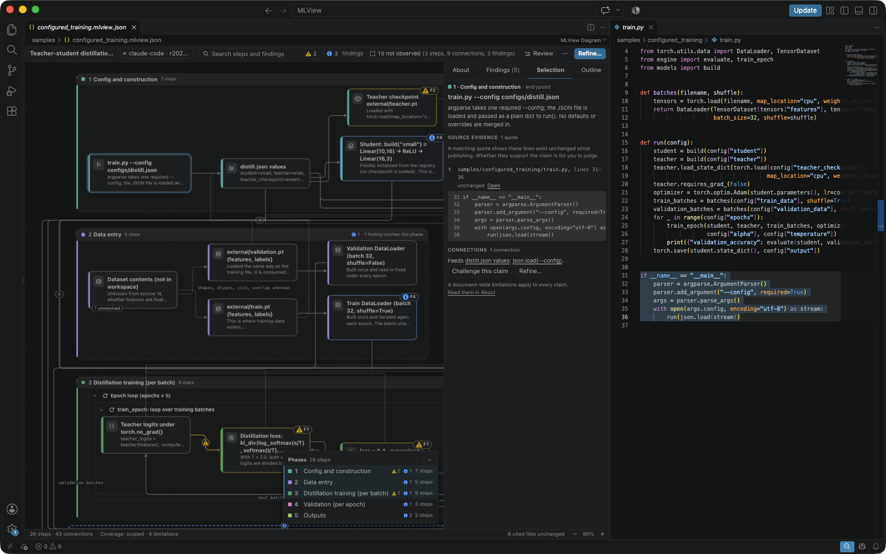
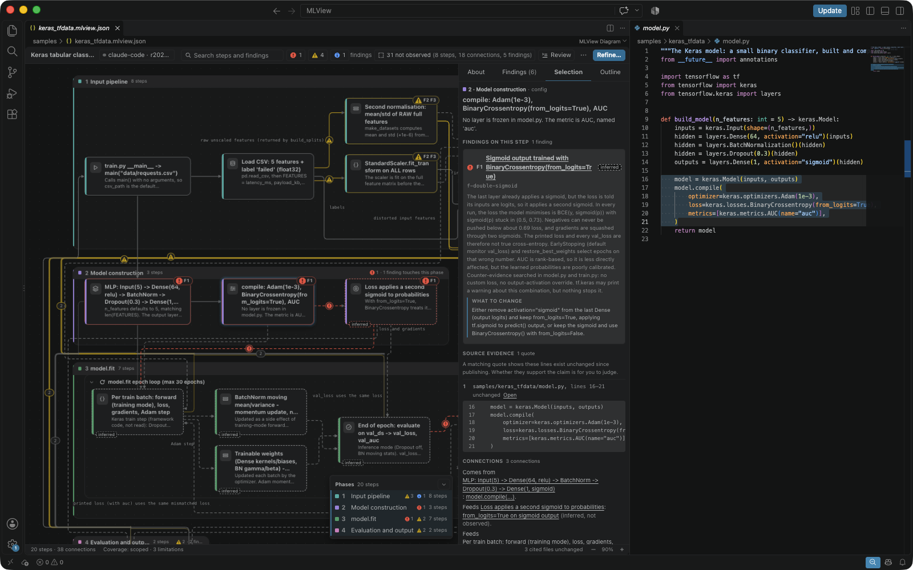
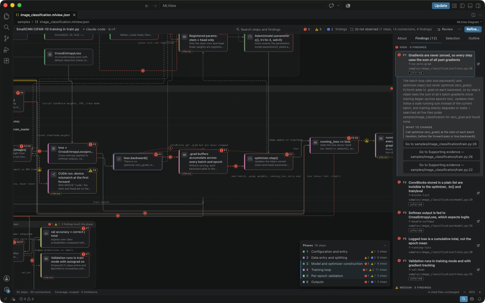

# MLView

MLView opens workflow diagrams of machine-learning code in VS Code. Your
coding assistant (GitHub Copilot, Codex or Claude Code) writes a diagram with
the `mlview` skill: a `*.mlview.json` file of steps, connections and
findings, with quotes from the files that it read. This extension draws the
file and opens the cited lines beside it.

MLView is a preview. The format and the viewer can still change between
releases, and fixes go into the next release.

The diagram of `samples/configured_training`, with a step selected.

A claim's quote and the lines that it cites.

The Findings tab of the diagram of `samples/image_classification`. The
maintainer wrote this project with mistakes on purpose. The findings are
the assistant's reading of the code, and they are not confirmed to be those
mistakes.

## Get started

The extension has nothing to show until a project holds a diagram.

1. Install the skill for your assistant. See
   [Install](https://github.com/realmyang/MLView/blob/v0.4.0/docs/user-guide.md#install)
   in the user guide.
2. Ask your assistant for a diagram.
   [Ask for a diagram](https://github.com/realmyang/MLView/blob/v0.4.0/docs/user-guide.md#ask-for-a-diagram)
   says how to start the skill and what a session writes.
3. Click the `*.mlview.json` file in the Explorer. It opens as the diagram.

To look at a diagram first, without an assistant, clone the
[repository](https://github.com/realmyang/MLView), open the clone in VS Code
and click `samples/configured_training.mlview.json`.

To write a diagram you need one of the three assistants, and Python 3.10 or
newer for the skill's helper.

## What you can do

- Read a diagram: its phases, steps and connections, with a side panel for
  the request, the findings and the selected claim.
  [Open and read a diagram](https://github.com/realmyang/MLView/blob/v0.4.0/docs/user-guide.md#open-and-read-a-diagram)
- Check a claim: select a step, a connection or a finding, and press Enter to
  open the cited lines beside the diagram.
  [Check a claim](https://github.com/realmyang/MLView/blob/v0.4.0/docs/user-guide.md#check-a-claim)
- Go through a diagram claim by claim with the review walk. For a connection
  with an end out of view, the walk shows where that end lies, and `o` brings
  it into view.
  [The review walk](https://github.com/realmyang/MLView/blob/v0.4.0/docs/user-guide.md#the-review-walk)
- Go from a line of code to the claim that cites it with **Reveal in
  Diagram**.
  [From code to the diagram](https://github.com/realmyang/MLView/blob/v0.4.0/docs/user-guide.md#from-code-to-the-diagram)
- See the whole workflow at once in the phase overview, and go to a phase
  from the phase index.
  [Move around a large diagram](https://github.com/realmyang/MLView/blob/v0.4.0/docs/user-guide.md#move-around-a-large-diagram)
- Ask your assistant for a refinement with a prompt that the viewer copies.
  [Refine](https://github.com/realmyang/MLView/blob/v0.4.0/docs/user-guide.md#refine)
- See what a new revision added, removed or changed.
  [Revisions and what changed](https://github.com/realmyang/MLView/blob/v0.4.0/docs/user-guide.md#revisions-and-what-changed)
- See which cited files changed after the diagram was published.
  [When sources change](https://github.com/realmyang/MLView/blob/v0.4.0/docs/user-guide.md#when-sources-change)
- Export the diagram as an SVG or a PNG image.
  [Export](https://github.com/realmyang/MLView/blob/v0.4.0/docs/user-guide.md#export)
- Work from the keyboard.
  [Keyboard](https://github.com/realmyang/MLView/blob/v0.4.0/docs/user-guide.md#keyboard)

## Requirements

- VS Code 1.100.0 or newer, as the manifest declares in `engines.vscode`.
- Opening a diagram needs no Python and no Node: the extension starts no
  process of its own.
- Virtual workspaces are not supported, as the manifest declares. MLView
  reads a diagram file and the files that it cites from the local disk.

## Commands

| Command | Where it is offered |
|---|---|
| **MLView: Open Generated Diagram** | The Command Palette. For a `*.mlview.json` file: the Explorer's context menu, the editor's context menu, and the title bar when the file is open as text. |
| **MLView: Reveal in Diagram** | The Command Palette and the editor's context menu, in a file that an open diagram cites and that has not changed since the diagram was published. |

MLView adds no key binding and no setting to VS Code.

## Privacy and limits

The extension calls no model and opens no network connection. Its code loads
no network module, and the page that draws the diagram is given a content
security policy that allows no connection.

Your assistant writes the diagram. It processes the code that it reads under
its own terms and settings.

No check judges whether a diagram is right.
[What is checked, and what is not](https://github.com/realmyang/MLView/blob/v0.4.0/docs/validation.md)
says what the checks cover.

## More

- [User guide](https://github.com/realmyang/MLView/blob/v0.4.0/docs/user-guide.md)
- [The format and the helper's commands](https://github.com/realmyang/MLView/blob/v0.4.0/docs/format.md)
- [Changelog](https://github.com/realmyang/MLView/blob/v0.4.0/CHANGELOG.md)
- [Issues](https://github.com/realmyang/MLView/issues)
- [License](https://github.com/realmyang/MLView/blob/v0.4.0/LICENSE)
